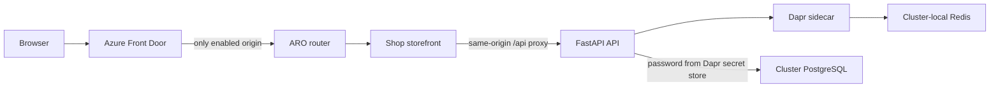
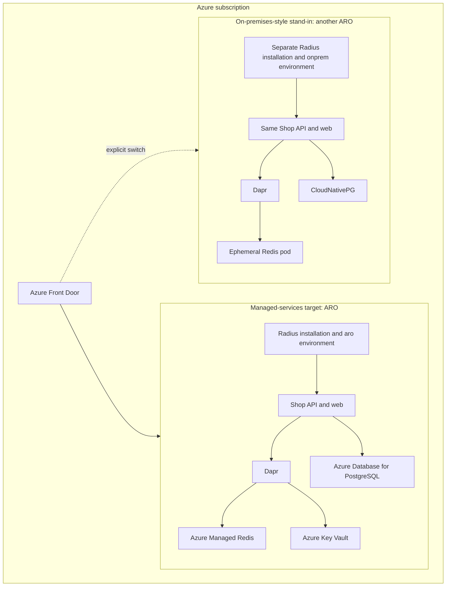

# Architecture

## Request path

Front Door has one origin group and two origins, initially disabled until a
target has been deployed. `scripts/90-switch-traffic.sh` enables exactly one
origin and disables the other. The target's ARO route serves the storefront;
the storefront proxies `/api/*` to the API service so the browser uses one
origin.

## Platform placement

The “on-premises-style” label describes only the recipe choice in the demo; that
cluster is also hosted in Azure. The same application Bicep is deployed to two
independent Radius environments. Radius is installed in each cluster because
the generic Kubernetes provider targets the cluster where that Radius
installation runs.

## State and secrets

- Each PostgreSQL target receives its own copy of the small product catalog.
- Dapr state management stores the cart in each target's Redis. There is no
  shared Redis and no synchronization.
- The API retrieves the PostgreSQL password through Dapr. The ARO target reads
  Key Vault using workload identity; the stand-in uses Dapr's Kubernetes
  secret store and a namespace-scoped read permission.
- Azure PostgreSQL is seeded from `app/api/init.sql` by a short-lived,
  restricted `psql` pod after the database resource is ready. The
  CloudNativePG recipe initializes the same SQL independently.

Failover changes traffic destination only. It is expected that carts differ
between clusters and database changes made in one target do not appear in the
other.
